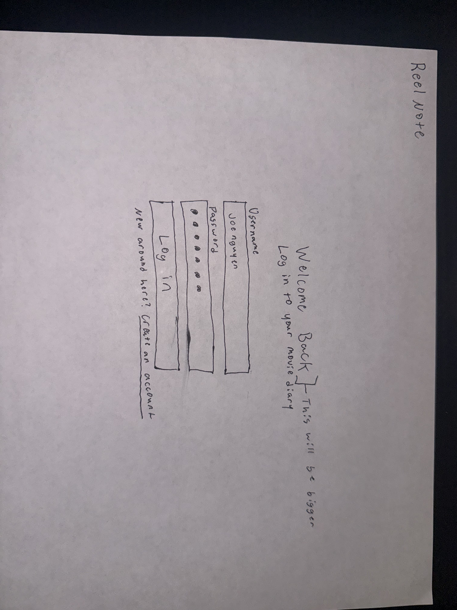
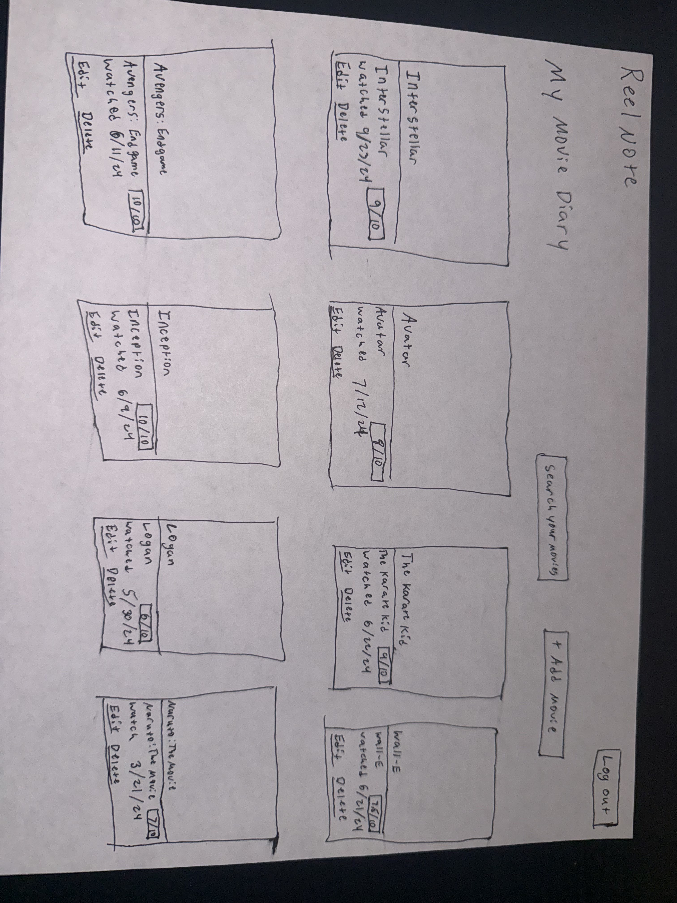
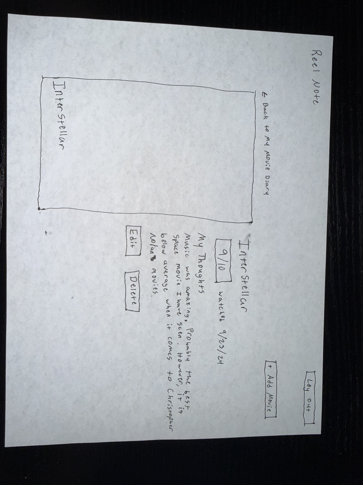
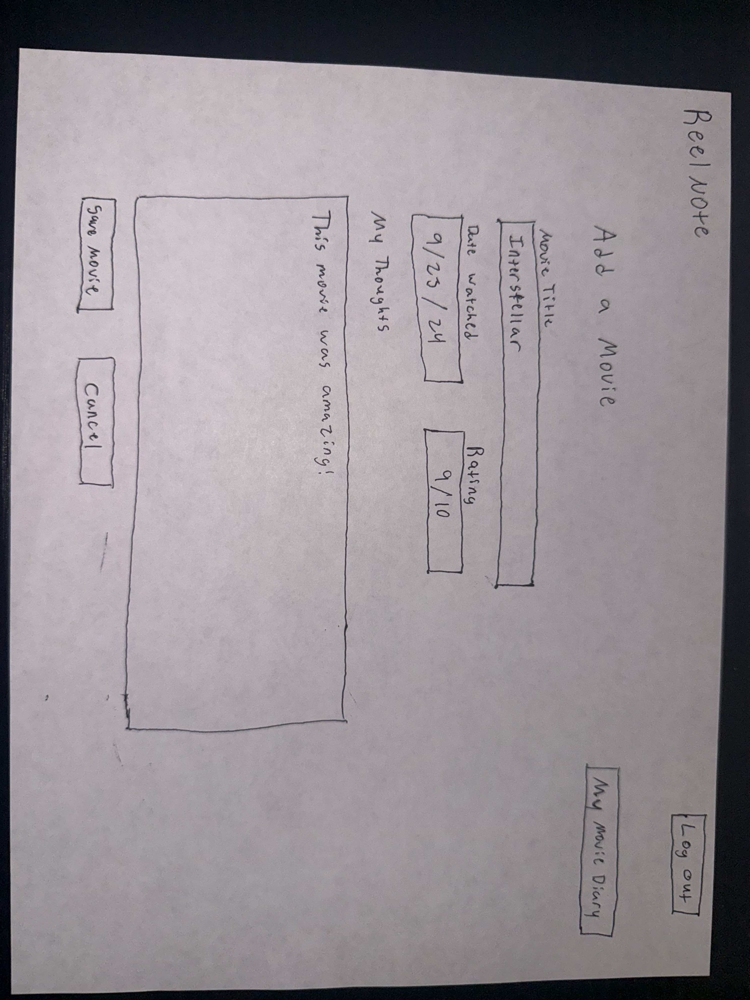
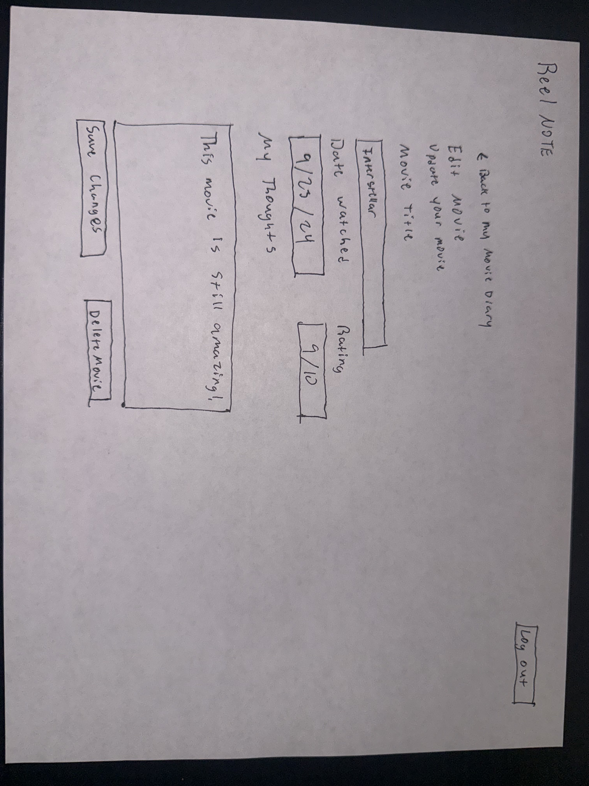

# ReelNote Mockup

### Login Page
- Supports user stories 1 and 2

### Dashboard Page
- Supports user stories 3, 6, 7

### View a Movie Page
- Supports user story 3, 6, 7

### Add a Movie Page
- Supports user stories 3, 4, 5

### Edit Movie Page
- Supports user story 7

# ReelNote User Stories

## User Stories 1 

As a **new user**, I want to **create an account** so I can **keep a personal diary of movies I have watched**. 

### Acceptance Criteria: 

- Users can register with a unique username and password 
- The system prevents duplicate usernames 

## User Stories 2 

As a **registered user**, I want to **log into my account** so I can **access my personal movie diary**. 

### Acceptance Criteria: 

- Users can log in with valid credentials 
- Incorrect credentials are rejected 
- Successfully authenticated users are redirected to their dashboard 

## User Stories 3 

As a **registered user**, I want to **add movies I have watched** so I can **keep track of my viewing history**. 

### Acceptance Criteria 

- Users can enter a movie title, date watched, and rating  
- Users can save a movie to their personal diary 

## User Stories 4 

As a **registered user**, I want to **rate movies on a scale of 1-10** so I can **remember how much I liked the movie**. 

### Acceptance Criteria: 

- Users can assign a rating 1-10 
- Ratings outside the allowed range are rejected 
- Ratings are saved with their corresponding movies 

## User Stories 5 

As a **registered user**, I want to **write personal movie reviews** so I can **remember my thoughts and impressions after watching a movie**. 

### Acceptance Criteria: 

- Users can write a review for a movie 
- Reviews are saved with the corresponding movie 
- Users can view their previously written reviews 

 
## User Stories 6 

As a **registered user**, I want to **view my previously watched movies** so I can **revisit my ratings, reviews, and movies watched**. 

### Acceptance Criteria: 

- Users can view their saved movies 
- Each entry displays its title, rating, and date watched 
- Users can only view their own movie entries 

## User Stories 7 

As a **registered user**, I want to **edit or delete movie entries** so I can **keep my personal movie diary accurate and organized**. 

### Acceptance Criteria: 

- Users can edit their movie titles, ratings, dates, and reviews 
- Users can delete saved movie entries 
- Changes are reflected in their movie history 
- Users cannot edit/delete another user's entries 

# ReelNote Mis-user Stories

## Mis-user Story 1

As a **malicous user**, I want to **access another user's movie diary** so I can **view their movie history, ratings, and reviews without permission**.

### Mitigation Criteria:

- Users must be authenticated before accessing their personal diaries
- The system verifies that users can only view movie entries associated with their accounts

## Mis-user Story 2

As a **malicous user**, I want to **edit or delete another user's movie entries** so I can **alter/destroy their saved movies**.

### Mitigation Criteria:

- Users can only modify movie entries associates with their accounts
- Unauthorized modifications attempts are rejected without changing the stored information
- The system checks that the movie entry belongs to the logged-in user before allowing changes

## Mis-user Story 3

As a **malicous user**, I want to **trick a logged-in user into submitting an unauthorized request** so I can **modify/delete their movie entries without their knowledge**.

### Mitigation Criteria:

- Adding, editing, and deleting movies must use POST requests with valid CSRF tokens
- The system rejects requests that fail CSRF validation

